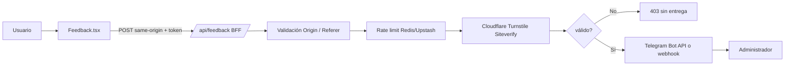
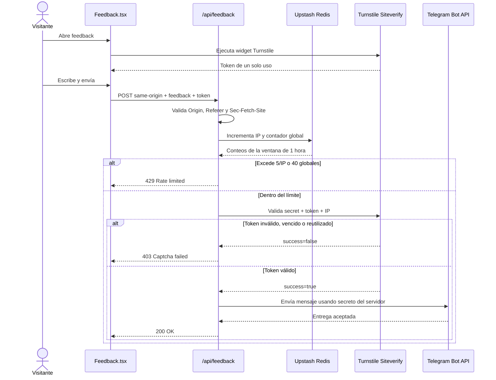

# Feedback: flujo y seguridad

La caja de feedback usa un BFF dentro de Next.js: el navegador nunca recibe el token del bot de Telegram ni conoce el destino final. El cliente solo llama a `POST /api/feedback` en el mismo dominio.

## Componentes



## Secuencia de un envío



## Protecciones implementadas

- **BFF:** el cliente solo conoce `/api/feedback`; `TELEGRAM_BOT_TOKEN`, `FEEDBACK_CHAT_ID` y `FEEDBACK_WEBHOOK_URL` nunca se exponen al navegador.
- **Turnstile:** CAPTCHA gratuito de Cloudflare. Se activa configurando `NEXT_PUBLIC_TURNSTILE_SITE_KEY` y `TURNSTILE_SECRET_KEY`. El backend valida siempre el token contra `siteverify`; no alcanza con mostrar el widget en el cliente.
- **Widget robusto:** usa `action: "feedback"`, reintento si el script no carga y resetea el token después de cada envío. El servidor verifica `success`, `action` y `hostname`.
- **Cliente BFF:** `src/lib/bff-client.ts` centraliza las llamadas same-origin y traduce errores sin exponer secretos ni destinos externos al navegador.
- **Rate limit por IP:** máximo de **5 feedbacks por IP por hora**.
- **Rate limit global:** máximo de **40 feedbacks por hora** para evitar saturar Telegram aunque el ataque distribuya las IPs.
- **Redis/Upstash:** los contadores son compartidos entre instancias serverless. Sin Redis, el desarrollo usa un fallback en memoria que no debe considerarse protección suficiente para producción.
- **Origen:** se aceptan únicamente `Origin`/`Referer` del mismo host y se rechazan navegaciones cross-site mediante `Sec-Fetch-Site` cuando el navegador lo informa.
- **Honeypot:** el campo oculto `website` detecta formularios rellenados automáticamente.
- **Validación de entrada:** tipo, mensaje, contexto, página y token tienen límites de tamaño y formato.
- **Timeout externo:** la validación de Turnstile tiene un timeout de 5 segundos para no dejar funciones abiertas indefinidamente.

## Variables de entorno

```env
# Ya existentes
TELEGRAM_BOT_TOKEN=
FEEDBACK_CHAT_ID=
KV_REST_API_URL=
KV_REST_API_TOKEN=

# Turnstile gratuito
NEXT_PUBLIC_TURNSTILE_SITE_KEY=
TURNSTILE_SECRET_KEY=
TURNSTILE_HOSTNAMES=localhost,127.0.0.1
```

La site key puede estar en el navegador. El secret nunca debe estar en variables `NEXT_PUBLIC_*` ni en el repositorio.

### `TURNSTILE_HOSTNAMES`

Esta variable define los hostnames autorizados para generar el token de Turnstile. Cloudflare devuelve el hostname junto con el resultado de `siteverify` y el BFF exige que coincida con uno de los valores configurados. Esto evita reutilizar un token válido generado para otro sitio.

Los valores se separan por coma y no llevan protocolo, ruta ni puerto:

```env
# Desarrollo
TURNSTILE_HOSTNAMES=localhost,127.0.0.1

# Producción con Vercel y dominio propio
TURNSTILE_HOSTNAMES=colejuy.vercel.app,colejuy.com.ar
```

Los mismos hostnames deben estar autorizados en la configuración del widget de Cloudflare. En producción no se deben dejar `localhost` ni `127.0.0.1`.

## Limitaciones y defensa adicional

CORS y `Origin` no pueden impedir por sí solos un `curl`: un cliente no navegador puede falsificar headers. Por eso la defensa depende de la combinación de Turnstile, rate limit, honeypot y validación server-side.

Para reducir costos de ingress frente a un ataque volumétrico, el siguiente nivel es agregar una regla de WAF o firewall en el proveedor de borde para limitar `/api/feedback` antes de que la solicitud llegue a Next.js. El rate limit del BFF protege Telegram y la aplicación, pero una solicitud ya alcanzó la infraestructura.

En desarrollo se pueden usar las claves de prueba de Turnstile. Para producción, registrar explícitamente los hostnames permitidos y no habilitar `localhost` en el widget productivo.
